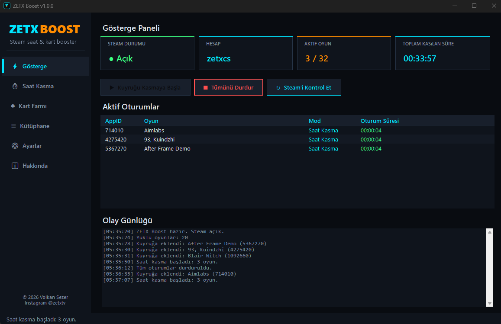
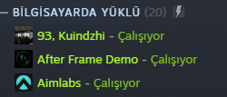
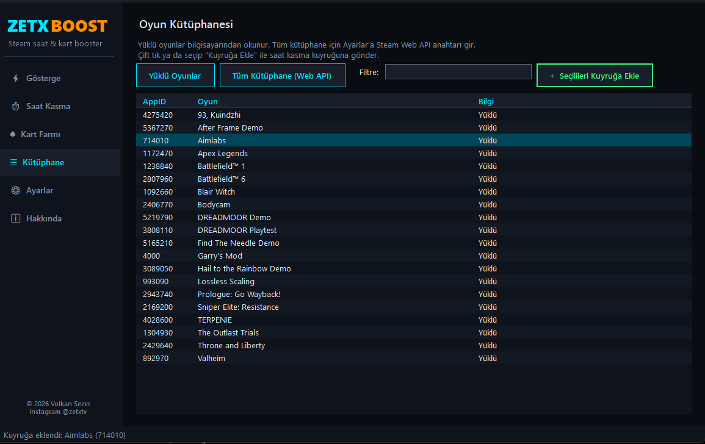

<p align="center">
  
</p>

<h1 align="center">ZETX BOOST</h1>

<p align="center">
  <b>Steam saat kasma (Hour Boost) ve kart farmı (Trading Cards) aracı</b><br>
  Windows 10 / 11 · x64 · Tek dosya, kurulum gerektirmez
</p>

<p align="center">
  <a href="https://github.com/wolkansezer/zetx-boost/releases/latest"><b>⬇ ZETXBoost.exe İndir (v1.0.0)</b></a>
</p>

---



## Nedir?

ZETX Boost, Steam kütüphanendeki oyunları **gerçekten açmadan** Steam'de "oynanıyor" olarak gösterir. Böylece:

- Oyunların **oynanma süresi (saat)** artar,
- Oyunlardan **Steam takas kartları** düşer (rozet yapımı / pazarda satış için),
- Bu sırada Steam'de **normal oyun oynamaya ve arkadaşlarınla sohbete devam edebilirsin.**

Oyunun bilgisayarında yüklü olması gerekmez; **kütüphanende olması yeterlidir.**



## Özellikler

| Modül | Açıklama |
|---|---|
| ⚡ **Gösterge** | Steam durumu, aktif hesap, aktif oyun sayısı (x/32), toplam kasılan süre, canlı oturum listesi ve olay günlüğü |
| ⏱ **Saat Kasma** | AppID / mağaza linki / isimle mağaza araması ile kuyruğa ekleme, aynı anda **32 oyuna kadar** kasma, oyun başına süre sayacı |
| ⏲ **Süre sınırı** | "X dakika sonra durdur" ile otomatik bitirme |
| ↻ **Yeniden başlatma** | Belirlenen aralıklarla oyunları kapatıp yeniden açma |
| ♠ **Kart Farmı** | Rozet sayfasını tarar, kartı kalan oyunları otomatik kasar, kartı biten oyundan sonrakine geçer |
| ☰ **Kütüphane** | Yüklü oyunları otomatik listeler; Steam Web API anahtarı ile tüm kütüphane |
| ⚙ **Ayarlar** | steam_api64.dll otomatik bulma, Windows ile başlatma, sistem tepsisine küçültme, açılışta otomatik kasma |
| 🔒 **Güvenlik** | Steam şifresi istenmez; kart farmı çerezi yalnızca o bilgisayarda Windows DPAPI ile şifreli saklanır |



### Kart farmı modları

| Mod | Çalışma şekli |
|---|---|
| **Akıllı** | 2 saatin altındaki oyunlar birlikte kasılır; hepsi 2 saati geçince oyunlar tek tek kasılır (Idle Master mantığı) |
| **Hepsi birden** | Kartı kalan tüm oyunlar aynı anda (en fazla 32) |
| **Tek tek** | Sırayla bir oyun |

Rozet sayfası belirlenen aralıkta (varsayılan 5 dk) yeniden taranır, kartı biten oyun bırakılır, tüm kartlar düşünce farm kendiliğinden durur.

## Kullanım

1. **Steam'i aç** ve hesabına giriş yap.
2. [Releases](https://github.com/wolkansezer/zetx-boost/releases/latest) sayfasından **ZETXBoost.exe**'yi indir ve çalıştır.
3. `steam_api64.dll` yüklü oyunlarından otomatik bulunur. Bulunamazsa: **Ayarlar → Gözat** ile herhangi bir Steam oyununun klasöründeki `steam_api64.dll` dosyasını seç.
4. **Saat Kasma** sekmesinde oyun ekle (AppID, mağaza linki ya da arama) veya **Kütüphane** sekmesinden seç → **Başlat**.

### Kart farmı için çerez (steamLoginSecure)

1. Tarayıcıda **steamcommunity.com**'a Steam hesabınla giriş yap.
2. **F12** → *Application / Uygulama* → *Cookies* → `https://steamcommunity.com`
3. `steamLoginSecure` satırının **Value** değerini kopyala, ZETX Boost → **Kart Farmı** sekmesine yapıştır.

> ⚠️ Bu değer şifren gibidir, kimseyle paylaşma. ZETX Boost onu yalnızca `steamcommunity.com`'a gönderir.

## Nasıl çalışır?

ZETX Boost, SingleBoostr ile aynı prensiple çalışır: kasılan her oyun için gizli bir alt işlem açılır (`ZETXBoost.exe --idle APPID`). Bu işlem `SteamAppId` ile `steam_api64.dll` üzerinden yerel Steam istemcisine bağlanır ve Steam bunu oyun oynanıyor sayar. Ana program kapanınca tüm alt işlemler de kapanır.

- Her kasılan oyun yaklaşık 30–40 MB RAM kullanır.
- Steam aynı anda en fazla 32 oyunun kasılmasına izin verir.
- Ayarlar `%AppData%\ZETX Boost\settings.json` içinde tutulur.

## Kaynak koddan derleme

Gereksinim: [.NET 8 SDK](https://dotnet.microsoft.com/download/dotnet/8.0) (x64)

```bat
build.bat
```

veya

```bash
dotnet restore --configfile nuget.config
dotnet publish ZETXBoost.csproj -c Release -o cikti
```

Çıktı: `cikti/ZETXBoost.exe` (self-contained, tek dosya; .NET kurulu olmayan bilgisayarda da çalışır).

| Dosya | Görev |
|---|---|
| `Program.cs` | Giriş noktası, tek örnek kontrolü, `--idle` alt işlem modu |
| `IdleWorker.cs` | Alt işlem: steam_api64.dll yükleme, Steam'e bağlanma |
| `IdleManager.cs` | Alt işlemleri başlatma / durdurma / izleme |
| `CardFarmEngine.cs` | Kart farmı mantığı (Akıllı / Hepsi / Tek tek) |
| `SteamWeb.cs` | Mağaza araması, Web API, rozet sayfası taraması |
| `SteamLocator.cs` | Steam yolu, kütüphaneler, yüklü oyunlar, aktif kullanıcı |
| `AppSettings.cs` | Ayarlar, Windows başlangıç, DPAPI şifreleme |
| `MainForm.cs` / `Theme.cs` | Arayüz ve koyu HUD teması |

## Program Sahibi

**Volkan Sezer**

- 📧 E-posta: [volkan.sezer@outlook.com.tr](mailto:volkan.sezer@outlook.com.tr)
- 📷 Instagram: [@zetxtv](https://www.instagram.com/zetxtv/)

## Uyarı

ZETX Boost bağımsız bir araçtır; **Valve Corporation veya Steam ile bağlantılı değildir.** Steam ve Steam logosu Valve Corporation'ın ticari markalarıdır. Saat kasma ve kart farmı yıllardır yaygın şekilde kullanılır, ancak Steam kullanım şartları değişebilir; kullanımdan doğacak sorumluluk kullanıcıya aittir.

© 2026 Volkan Sezer · Tüm hakları saklıdır.
